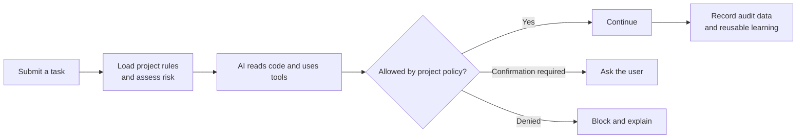

# repo-agent

English | [简体中文](./README.md)

[](https://github.com/tanglitong/repo-agent/actions/workflows/ci.yml)
[](./LICENSE)

repo-agent 1.0.0 is an offline-first, repository-native governance layer for AI-assisted software development. It injects trusted project context before each task, applies policy checks before tool use, and records audit, learning, recurring-error, and health information when a task ends.

repo-agent does not replace an AI client. It runs alongside Codex, Claude Code, and OpenCode. Node.js 18 or later is required.

## How it works



repo-agent does not create or modify `AGENTS.md` or `CLAUDE.md`. It maintains its own `.repo-agent/` directory and managed client integration files.

## Install

Download `repo-agent-node-offline.zip` from [GitHub Releases](https://github.com/tanglitong/repo-agent/releases). Before the first Release is available, build it from source:

```bash
git clone https://github.com/tanglitong/repo-agent.git
cd repo-agent
npm ci
npm run package:offline
```

The archive is written to `release/repo-agent-node-offline.zip`. Place it in the target repository root.

macOS/Linux:

```bash
unzip repo-agent-node-offline.zip
node repo-agent/repo-agent.bundle.js init --mode team --tool all --entry auto
```

Windows PowerShell:

```powershell
Expand-Archive .\repo-agent-node-offline.zip -DestinationPath .
node .\repo-agent\repo-agent.bundle.js init --mode team --tool all --entry auto
```

Open a new AI client session after installation.

## Verify

```bash
node repo-agent/repo-agent.bundle.js validate --strict
node repo-agent/repo-agent.bundle.js doctor
node repo-agent/repo-agent.bundle.js health check --deep
node repo-agent/repo-agent.bundle.js handshake --tool auto
```

## Develop

```bash
npm ci
npm run typecheck
npm test
npm run package:offline
```

Release preparation uses:

```bash
npm run release:prepare
npm run release:verify
```

## Self-governance

This repository uses repo-agent to govern its own development. It commits the `.repo-agent/` team assets, the `repo-agent/` offline runtime, and project-level integrations for Codex, Claude Code, and OpenCode.

Building and testing the source does not require an AI client. Compatible clients may load the committed project integrations. To remove those integrations from a local working tree:

```bash
node repo-agent/repo-agent.bundle.js deactivate --tool all
```

This only removes client integrations and leaves governance assets and runtime data intact. Managed integration files will appear as local Git changes.

## Documentation

- [Documentation index](./docs/README.md)
- [Chinese user guide](./docs/zh-CN/usage.md)
- [Chinese architecture guide](./docs/zh-CN/architecture.md)
- [Security policy](./SECURITY.md)
- [Contributing guide](./CONTRIBUTING.md)
- [Code of conduct](./CODE_OF_CONDUCT.md)
- [Support](./SUPPORT.md)
- [Changelog](./CHANGELOG.md)
- [MIT license](./LICENSE)
- [Third-party notices](./THIRD_PARTY_NOTICES)
