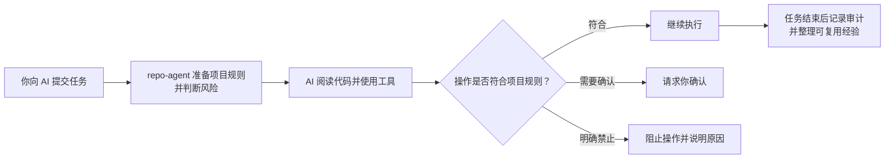

# repo-agent

[English](./README.en.md) | 简体中文

[](https://github.com/tanglitong/repo-agent/actions/workflows/ci.yml)
[](./LICENSE)

repo-agent 1.0.0 是**离线优先、随仓库交付的 AI 编程治理层**。它在 AI 会话每一轮任务开始前注入可信上下文并声明风险要求，在工具调用前执行策略拦截，在任务结束后自动完成审计、学习、重复错误分析和健康度量。它不替代任何 AI 客户端，只作为治理层运行；默认离线，Node.js 18 或更高版本。

## 一分钟理解

把 repo-agent 理解成 AI 编程工具旁边的一层“项目规则执行器”：



日常使用不要求先理解钩子、上下文协议或内部状态机。先完成安装和验证即可；需要排障或参与开发时，再阅读后面的专业内容。

**支持的 AI 客户端**

| 客户端 | 生命周期接入方式 | 是否支持模型上下文协议 |
|---|---|---|
| Codex | 原生钩子（Hook） | 支持 |
| Claude Code | 原生钩子（Hook） | 支持 |
| OpenCode | 项目插件（Plugin） | 支持 |

repo-agent 不会创建或修改仓库中的 `AGENTS.md`、`CLAUDE.md`；它只维护自己的目录 `.repo-agent/` 与集成配置。

## 安装

### 获取离线包

正式版本从 [GitHub Releases](https://github.com/tanglitong/repo-agent/releases) 下载 `repo-agent-node-offline.zip`。尚未发布 Release 时，可以从源码构建：

```bash
git clone https://github.com/tanglitong/repo-agent.git
cd repo-agent
npm ci
npm run package:offline
```

构建产物位于 `release/repo-agent-node-offline.zip`。

### 方式一：直接执行命令

把 `repo-agent-node-offline.zip` 放到目标项目根目录：

macOS/Linux：

```bash
unzip repo-agent-node-offline.zip
node repo-agent/repo-agent.bundle.js init --mode team --tool all --entry auto
```

Windows PowerShell：

```powershell
Expand-Archive .\repo-agent-node-offline.zip -DestinationPath .
node .\repo-agent\repo-agent.bundle.js init --mode team --tool all --entry auto
```

`--entry auto` 会为 Codex、Claude Code 安装原生钩子，为 OpenCode 安装项目插件，并为三个客户端配置模型上下文协议服务端。**配置更新后必须新建客户端会话**。

### 方式二：使用安装包 Skill

离线包的 `repo-agent/` 目录本身也是标准 Agent Skill。客户端或比赛平台加载该目录后，可通过以下入口打开交互菜单：

| 客户端 | 调用方式 |
|---|---|
| Codex | `$repo-agent`，或在 `/skills` 中选择 |
| Claude Code | `/repo-agent` |
| OpenCode | 首次安装后使用 `/repo-agent` |

Skill 可以完成安装、更新、诊断、客户端接入、经验审核、重复错误分析、闭环恢复和生命周期管理，底层仍调用同一个 `repo-agent.bundle.js`。写操作会先预演并请求确认。

团队成员拉取仓库后，日常同步与升级只需要一条命令：

```bash
node repo-agent/repo-agent.bundle.js update
```

`update` 自动决定要不要走升级路径：无升级包时只做幂等的接入修复；检测到 `release/*.zip` 或本地 `repo-agent/` 有更高版本时按迁移链应用增量并写事务日志，可加 `--rollback` 一键回滚。

## 验证接入是否生效

```bash
node repo-agent/repo-agent.bundle.js validate --strict   # 校验治理资产是否满足严格模式
node repo-agent/repo-agent.bundle.js doctor              # 环境自检（Node/命令/锁/schema）
node repo-agent/repo-agent.bundle.js health check --deep # 深度健康检查
node repo-agent/repo-agent.bundle.js handshake --tool auto # 与 AI 客户端握手
```

健康检查会把问题分成三档：

- `error`：模式约束（Schema）、事件（Event）、校验和（Checksum）等发布阻断问题。
- `warning`：闭环超时、锁陈旧、缺失工程能力等需要修复但不阻断发布的问题。
- `advisory`：候选资产积压等治理事项，不会降低运行健康分。

闭环率只统计已经进入终态的轮次（`closed`、`retryable_failed`、`abandoned`）；正在进行的轮次由 `activePreflights` 单独显示，超时后进入 `overduePreflights`。

## 什么该提交、什么不能提交

**应提交**

```text
repo-agent/                        # 离线运行程序
.repo-agent/                       # 正式团队治理资产、团队候选资产、生命周期提案
.agents/、.codex/、.claude/、.opencode/、.mcp.json、opencode.json    # AI 客户端接入配置和 Skill 入口
.gitignore 中 `# >>> repo-agent managed` ... `# <<< repo-agent managed` 区块
```

**不得提交**

```text
.repo-agent-private/     # 私人候选、观察、证据
.repo-agent-runtime/     # 运行时事件、闭环、锁、度量
.repo-agent/generated/   # 审计、报告、临时补丁
.repo-agent/catalog/     # 资产索引
dist/、release/          # 构建产物
```

候选资产（Candidate）不能直接覆盖已批准资产（Approved）。私人候选达到证据门槛后先晋升为团队候选，再由**非生成者**审核。团队已批准资产不会被 Stop 或维护任务自动删除。

## 本仓库如何使用 repo-agent

repo-agent 使用自身管理自身。仓库提交了 `.repo-agent/` 团队治理资产、`repo-agent/` 离线运行程序，以及 Codex、Claude Code 和 OpenCode 的项目级接入配置，贡献者可以直接检查一套真实运行的配置。

普通源码构建和测试不依赖 AI 客户端。兼容客户端打开本仓库时可能读取项目级钩子、插件或模型上下文协议配置；所有命令都使用仓库相对路径，repo-agent 默认离线运行。若不希望在本地启用这些接入，可以不加载项目级 AI 配置；已经启用时可执行：

```bash
node repo-agent/repo-agent.bundle.js deactivate --tool all
```

该命令只解除客户端接入，不删除治理资产、私人经验或运行记录，并会让受管理的接入文件在本地工作区显示为变更。

## 开发与发布（贡献者视角）

```bash
npm ci
npm run typecheck
npm test
npm run package:offline    # 生成 dist/ 与 release/*.zip，不改写仓库根安装目录
```

准备发布时显式执行：

```bash
npm run release:prepare    # 从同一 canonical stage 同步 ZIP 与 repo-agent/
npm run release:verify     # 逐文件比较 Manifest、Version、README、Bundle、Checksum
```

## 更多文档

- [文档中心](./docs/README.md)：源码仓库中的文档入口。
- [使用文档](./docs/zh-CN/usage.md)：面向使用者，按安装、验证、升级和排障等实际任务组织，并附术语表。
- [架构设计](./docs/zh-CN/architecture.md)：面向贡献者，解释内部架构、状态变化和工程约束。
- [安全说明](./SECURITY.md)：漏洞报告与安全边界。
- [贡献指南](./CONTRIBUTING.md)：开发流程、测试要求和 Pull Request 规则。
- [社区行为准则](./CODE_OF_CONDUCT.md)：参与项目时应遵循的协作规范。
- [支持说明](./SUPPORT.md)：问题分类和获取帮助的方式。
- [变更日志](./CHANGELOG.md)：公开版本变化。
- [MIT 许可证](./LICENSE)：使用、修改和分发条件。
- [第三方许可证](./THIRD_PARTY_NOTICES)：Bundle 所含运行时依赖的版权和许可证声明。

程序、模式约束（Schema）、模板（Template）和安装包均属于首发基线 1.0.0；配置和运行时事件版本为 1，首发包 `migrations=[]`。
