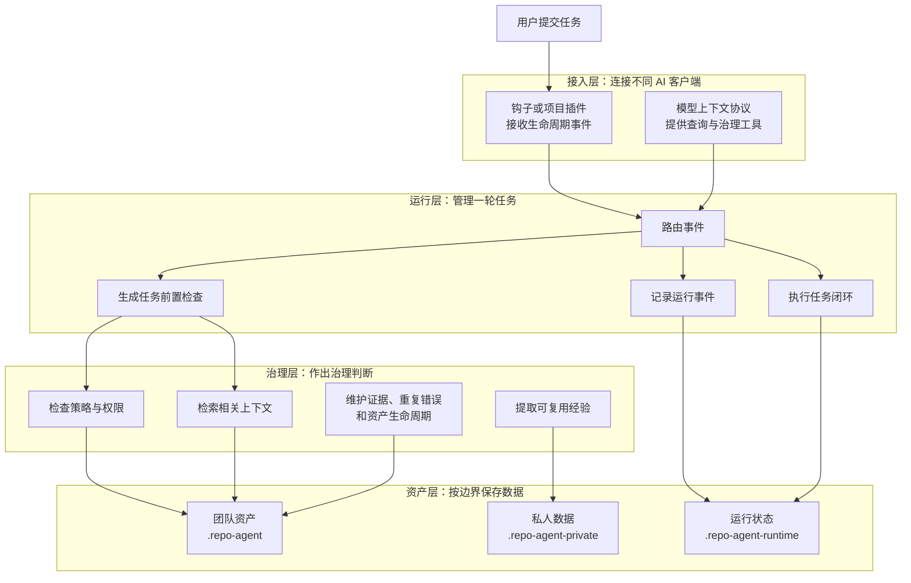
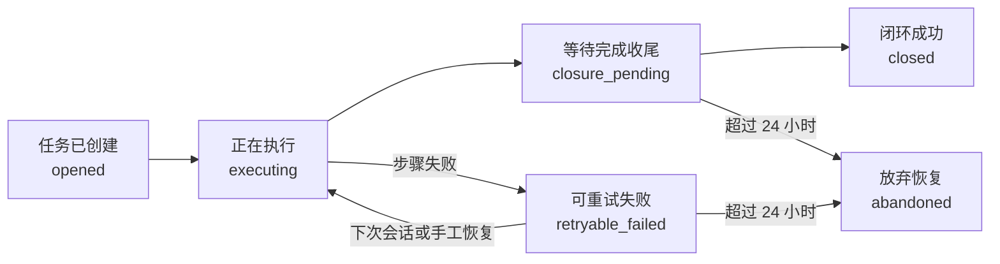
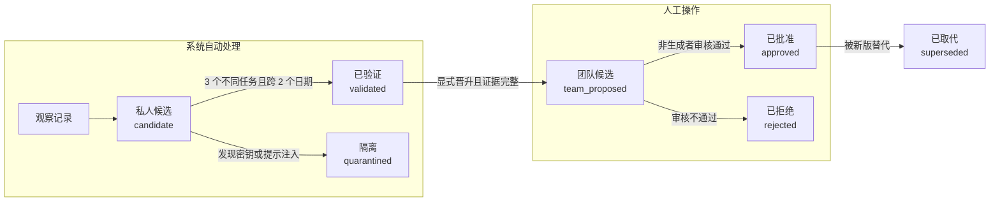
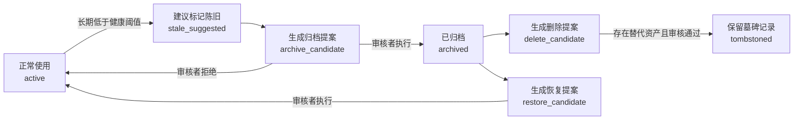
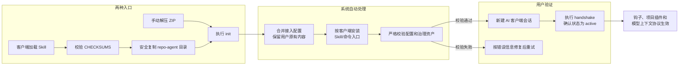

# repo-agent 架构设计（1.0.0）

## 1. 版本基线与不变量

```text
程序版本：1.0.0
配置版本：1
模式约束版本：1.0.0
模板版本：1.0.0
运行时事件版本：1
证据模型版本：1
```

不变量：

- 生命周期接入优先，不修改 `AGENTS.md`、`CLAUDE.md`。
- 默认离线，检索和治理不依赖外部模型。
- 候选资产（Candidate）不直接覆盖已批准资产（Approved）。
- 私人资产可自动清理。
- 团队已批准资产只能由系统自动生成提案，评审后才能归档、删除或恢复。
- 团队资产可提交；私人、运行时和派生数据不得提交。
- 时间使用带毫秒的 ISO 8601。
- 用户输出除专业名词外使用中文。

## 2. 四层架构

下图先展示一次任务如何经过四层处理。层与层之间传递的是任务事件、治理结论和数据，不代表每个模块都会在每轮执行。



主要模块：

| 模块 | 职责 |
|---|---|
| `hook-runtime.ts` | 钩子输入适配、任务前置检查、任务停止编排 |
| `hook-router.ts` | 路由结构和闭环步骤严格校验 |
| `event-store.ts` | 追加式运行事件和任务前置检查锁 |
| `closure-engine.ts` | 六步闭环状态机、幂等和恢复 |
| `context-builder.ts` | 可信内容隔离、长度预算和上下文组装 |
| `observation-manager.ts` | 原子观察和后台学习 |
| `candidate-manager.ts` | 候选资产、晋升、审核和基线版本 |
| `evidence-manager.ts` | 证据账本和健康分 |
| `recurring-error-detector.ts` | 不同任务之间的重复错误聚合 |
| `asset-lifecycle.ts` | 私人清理和团队生命周期提案 |
| `tool-manifest.ts` | 内置工具、输入格式、副作用、风险和审批的单一事实源 |
| `opencode-plugin.ts` | 生成 OpenCode 项目插件并映射生命周期事件 |

## 3. 数据边界

```text
.repo-agent/                 团队正式资产、团队候选、提案
.repo-agent-private/         观察记录、私人候选、证据、报告
.repo-agent-runtime/         事件、闭环、任务前置检查、锁、度量
repo-agent/                  可提交的离线运行程序
dist/、release/              源码仓库可重建产物
```

`.gitignore` 由起止标记包围的托管区块维护。结构化配置只删除或更新 repo-agent 管理块，不覆盖用户其他配置。

## 4. 事件存储（Event Store）

目录：

```text
.repo-agent-runtime/
  events/<session-id>/<preflight-id>.jsonl
  closures/<session-id>/<preflight-id>.json
  locks/<preflight-id>.lock
```

事件模型：

```ts
interface RuntimeEvent {
  version: 1;
  eventId: string;
  eventType:
    | "preflight_opened"
    | "context_built"
    | "tool_allowed"
    | "tool_blocked"
    | "closure_step_completed"
    | "closure_step_failed"
    | "turn_closed";
  sessionId: string;
  turnId: string;
  preflightId: string;
  occurredAt: string;
  producer: "hook" | "cli" | "mcp";
  idempotencyKey: string;
  payload: Record<string, unknown>;
}
```

约束：

- 事件逻辑上只追加；写入在锁内通过临时文件和原子重命名完成。
- 事件标识（Event ID）和幂等键（Idempotency Key）用于去重。
- 单事件不超过 256 KB。
- 单个任务前置检查不超过 10,000 个事件。
- 闭环锁覆盖处理器执行，防止并发任务停止事件产生重复副作用。
- 损坏和重复事件会影响健康检查结果，不会被静默忽略。

## 5. 任务闭环（Closure）



正常路径是“任务已创建 → 正在执行 → 等待完成收尾 → 闭环成功”。只有步骤失败时才进入可重试状态；系统会在下次会话开始或收到新任务时恢复。

步骤固定为：

```text
commit_advice
audit_recorded
observation_captured
recurring_analyzed
lifecycle_evaluated
metrics_updated
```

幂等键：

```text
sha256(preflightId + stepName + stepVersion)
```

设计规则：

- 每步成功立即写入事件和回执。
- 失败后停止后续步骤，只重试失败及未执行步骤。
- 手工执行 `record-trace` 只完成审计步骤。
- 会话开始和下一次用户提交任务事件会恢复同一会话最近未闭环的任务。
- 会话、轮次和任务前置检查不一致时采用失败即拒（Fail Closed）。

## 6. 钩子路由（Hook Router）

```yaml
version: 1
routes:
  session-start:
    handler: session_handshake
  user-prompt-submit:
    handler: task_preflight
    context_sources: [instructions, memories, skills, fix_patterns, candidates, recurring_errors]
    block_on_risk: [blocked]
  pre-tool-use:
    handler: tool_policy
  stop:
    handler: task_closure
    closure_steps: [commit_advice, audit_recorded, observation_captured, recurring_analyzed, lifecycle_evaluated, metrics_updated]
```

严格校验会检查处理器、上下文来源、闭环步骤、阻断风险、版本、重复项、缺失项和未知项。

配置模式使用 `additionalProperties=false`。所有公开配置必须存在运行时消费者和测试；项目语言、框架和命令由扫描器发现，执行环境由请求传入，不在静态配置中重复保存。

OpenCode 使用项目插件映射相同的路由：

| OpenCode 事件 | 统一路由 | 含义 |
|---|---|---|
| `session.created` | `session-start` | 会话开始 |
| `chat.message` | `user-prompt-submit` | 用户提交任务 |
| `tool.execute.before` | `pre-tool-use` | 使用工具前 |
| `session.idle` | `stop` | 本轮任务结束 |

`session.idle` 不能强制 OpenCode 模型继续运行，因此收尾失败时保留可恢复回执；下一条 `chat.message` 会在创建新任务前恢复旧闭环。

### 6.1 闭环健康指标口径

正在生成回复的任务不是失败，不能降低闭环率。健康指标将状态分成：

```text
活动态：opened、executing、closure_pending
终态：closed、retryable_failed、abandoned
```

24 小时和 7 天闭环率使用相同公式：

```text
TerminalClosureRate =
  ClosedTerminalPreflights
  / AllTerminalPreflights
```

无终态样本时闭环率定义为 1。活动态通过 `activePreflights` 单独展示；超过 `closure_policy.abandon_after_hours` 的活动态通过 `overduePreflights` 告警。`retryable_failed` 和 `abandoned` 进入分母但不进入分子；恢复为 `closed` 后重新计为成功。

该口径避免实时对话中的正常 `opened` 状态被误判为失败，同时仍能通过超时指标发现任务停止钩子丢失。

健康问题分为：

```text
error     模式约束、事件、校验和等发布阻断
warning   超时闭环、陈旧锁和缺失工程能力
advisory  候选资产积压等治理事项
```

健康分只扣减 error 和 warning，advisory 不把正常资产审核队列误判为运行故障。

## 7. 上下文检索


这条流水线先保证强制策略不丢失，再选择相关资产；未审核建议不会与可信资产混合。

信号：

- 本地 BM25（BM25 词频算法） 风格词频。
- 中文二元、三元 N-gram（N 元语法）。
- 路径、语言、框架、工具、任务类型和实体匹配。
- 质量、时效性、作用域匹配和多样性。

排序：

```text
Rank =
  0.55 × Relevance
+ 0.20 × Quality
+ 0.10 × Freshness
+ 0.10 × ScopeMatch
+ 0.05 × Diversity
```

`min_relevance=0.15`。零相关资产不召回；同一资产在同一任务中只记一次 `retrieved`，仅被检索到不会提高质量。

可信内容分区的数据结构：

```ts
interface ContextPack {
  mandatoryInstructions: ContextItem[];
  trustedAssets: ContextItem[];
  untrustedAdvisories: ContextItem[];
  recurringRecommendations: RecurringRecommendation[];
  budget: ContextBudget;
  risk: RiskResult;
}
```

候选资产不进入系统指令，始终标记为 `trusted:false`。包含提示注入、密钥读取或绕过策略的内容进入隔离区。

## 8. 词元预算（Token Budget）

```text
CJK Token = CJK 字符数
Latin Token = ceil(Latin 及数字字符数 / 4)
Estimated = CJK Token + Latin Token + JSON 结构开销
Final = ceil(Estimated × 1.2)
```

裁剪顺序：候选资产 → 修复模式 → 技能 → 记忆。强制策略不裁剪。已批准资产默认截取摘要，原文件仍是事实源。

## 9. 原子学习（Atomic Learning）

```ts
interface AtomicObservation {
  version: 1;
  observationId: string;
  projectId: string;
  preflightId: string;
  sessionId: string;
  observedAt: string;
  kind:
    | "correction"
    | "successful_resolution"
    | "failed_attempt"
    | "repeated_workflow"
    | "project_convention"
    | "security_boundary";
  trigger: string;
  action: string;
  outcome: string;
  scope: "project" | "personal";
  evidence: {
    changedFiles: string[];
    tests: string[];
    auditId?: string;
    toolEventIds: string[];
  };
  redactionStatus: "clean" | "redacted" | "rejected";
}
```

任务停止事件只负责限长、脱敏和追加写入。后台分析在新增 20 条记录、最旧记录超过 24 小时或收到显式命令时执行。

内容指纹：

```text
sha256(kind + normalizedTrigger + normalizedAction + scope)
```

语义合并：

```text
0.40 × BM25/词项重合
+ 0.30 × CJK N-gram/Jaccard
+ 0.20 × Trigger/Action 结构匹配
+ 0.10 × 可选 Embedding
```

阈值为 `0.82`。向量嵌入不可用时降级使用离线信号，不阻断分析。

资产晋升过程按责任主体分为“系统自动处理”和“人工审核”：



外部模型可用于原子化、聚类和冲突摘要，但输出必须通过模式校验，不能直接写入已批准资产。

## 10. 证据（Evidence）

```ts
interface EvidenceEvent {
  version: 1;
  evidenceId: string;
  assetId: string;
  preflightId: string;
  sessionId: string;
  occurredAt: string;
  type:
    | "retrieved"
    | "applied"
    | "validated_success"
    | "validated_failure"
    | "contradicted"
    | "review_approved";
  outcomeSource: "test" | "user" | "agent" | "review";
  confidence: number;
}
```

证据只追加，派生结果可以重新计算。测试、用户确认和人工审核的可信度高于 AI 自评；失败与矛盾证据不会被覆盖。

生命周期公式：

```text
Health =
  0.40 × QualityLowerBound
+ 0.25 × DistinctValidatedUse
+ 0.20 × Freshness
+ 0.15 × ReviewTrust
- ContradictionPenalty
```

质量下限使用 Beta 后验下界，时效性半衰期为 180 天。每个分量都可以通过 `evidence explain` 查看来源。

## 11. 重复错误（Recurring Error）

聚合维度：

```text
错误类型 + 规范化消息 + 根因类别 + 关键堆栈 + 受影响路径
```

统计单位是不同任务。阈值为 2/3/5；高风险问题的阈值减半，但最少需要 2 个不同任务。已被正式修复模式完整覆盖的错误不重复生成建议。

## 12. 生命周期

私人数据达到保留期后自动删除；审核中、手工保留和引用中数据不删除。

团队资产只能由系统生成提案，再由审核者改变实际状态：



任务停止事件和维护任务只能生成 `.repo-agent/lifecycle_proposals/`。删除后写入 `.repo-agent/tombstones/<asset-hash>.yaml`；严格校验会阻止旧分支重新引入该资产。没有替代资产时禁止删除。

## 13. 团队冲突

- 候选文件名由内容指纹确定。
- 相同标识、相同内容指纹视为同一候选。
- 相同标识、不同内容指纹进入冲突检查，禁止批准。
- 已批准资产的更新携带 `base_revision.sha256`。
- 基线版本改变时拒绝覆盖，要求人工三方合并。
- 合并目标必须存在。
- 审核记录包含审核者、时间、Git 提交和基线版本。

## 14. 安全

- 观察记录、候选资产和审计记录写入前必须脱敏或扫描敏感信息。
- 原始观察记录永远属于私人数据。
- 团队候选只共享结构化内容和证据引用。
- 包含提示注入的候选资产进入隔离区。
- 路径拒绝绝对路径和 `..`。
- 运行时数据有大小、数量、锁和保留期限制。
- 策略、安全规则、工作流和审查视角属于永久保护资产。

## 15. 命令行与模型上下文协议

治理 CLI：

```text
closure status
closure recover [--dry-run]
evidence explain <asset-id>
learning analyze [--dry-run]
candidate promote <candidate-id>
lifecycle propose [--dry-run]
lifecycle list
lifecycle apply <proposal-id>
lifecycle restore <asset-id>
health check --deep --json
```

模型上下文协议工具：

```text
get_closure_status
recover_closure
get_asset_evidence
search_assets
promote_candidate
get_health_metrics
```

协议工具参数使用 camelCase。每个工具拒绝未知字段和错误类型；稳定错误为 `E_INVALID_TOOL_INPUT`。钩子适配器负责转换 snake_case 输入。通知请求不返回响应，批量请求按 JSON-RPC 2.0 返回。

### 15.1 工具清单（Tool Manifest）与策略分层

内置协议工具只在 `tool-manifest.ts` 声明一次。`tools/list`、输入校验、处理器编译期映射、策略和 Codex 审批配置都读取同一份清单。

```text
工具清单
├── 名称、说明和输入格式
├── 副作用、风险和审批方式
├── 模型上下文协议注解
├── 工具列表和处理器
├── 策略引擎
└── Codex 单工具审批配置
```

`.repo-agent/tools/registry.yaml` 不再枚举内置工具，只管理外部工具和项目级收紧覆盖。审批规则从上到下匹配：

| 优先级 | 来源 | 结果 |
|---:|---|---|
| 1 | 明确禁止（`deny`） | 直接阻止 |
| 2 | 项目要求确认（`requires_confirmation`） | 请求用户确认 |
| 3 | 工具清单要求确认（`prompt`） | 请求用户确认 |
| 4 | 工具清单允许（`approve`） | 自动放行 |

项目策略不能把工具清单中的 `prompt` 放宽为 `approve`。未知的 `mcp__repo_agent__*` 工具视为版本漂移或伪造，并采用失败即拒；其他未知外部工具交给客户端审批。

Codex 的工具执行前事件负责硬阻断和上下文记录，不模拟客户端不支持的 `ask`。安装器为 repo-agent 服务端生成 `default_tools_approval_mode = "prompt"`，并仅为安全工具生成 `approval_mode = "approve"`。Claude Code 钩子对需要确认的工具返回原生 `ask`。OpenCode 项目插件在工具执行前实施硬阻断，并在 `opencode.json` 中把有副作用的工具收紧为 `ask`，且不覆盖已有的 `deny`。

## 16. 安装、同步、升级事务

离线包同时提供 CLI 和 Agent Skill 两个入口，但二者共享同一个运行程序：

```text
repo-agent/
  SKILL.md
  agents/openai.yaml
  scripts/install.mjs
  references/command-map.md
  repo-agent.bundle.js
  README.md
  使用文档.md
```

Skill 源文件保存在源码仓库的非发现目录，只有打包时才进入上述结构，因此源码开发仍使用 npm，不会自动加载 repo-agent Skill。



客户端入口由 `activate` 管理：

| 客户端 | 托管路径 | 用户入口 |
|---|---|---|
| Codex | `.agents/skills/repo-agent/` | `$repo-agent` 或 `/skills` |
| Claude Code | `.claude/skills/repo-agent/` | `/repo-agent` |
| OpenCode | `.opencode/skills/repo-agent/`、`.opencode/commands/repo-agent.md` | `/repo-agent` |

`entry=none` 不安装入口；`update` 重放接入动作并修复缺失文件；`deactivate` 只删除带 repo-agent 标记的已知文件。目标 `SKILL.md` 或 OpenCode 命令缺少托管标记时返回 `E_INTEGRATION_CONFLICT`，不得覆盖或删除。未知文件即使位于托管 Skill 目录中也必须保留。

`update` 是统一入口：无升级包时执行幂等的接入修复；检测到更高版本的升级包时，先校验发布清单和校验和，再按迁移链生成计划、写入事务日志并应用安全增量。`--rollback [runId]` 根据事务日志逐文件恢复。`package:offline` 只生成 ZIP；`release:prepare` 从同一标准暂存目录同步 ZIP 和仓库安装目录；`release:verify` 逐文件比较发布清单、版本、README、构建产物和校验和。私人资产和团队累积资产不会被覆盖。首发 1.0.0 的 `migrations=[]`。

## 17. 错误模型

| 错误码 | 含义 |
|---|---|
| `E_PROJECT_NOT_INITIALIZED` | 项目未初始化 |
| `E_CONFIG_SCHEMA` | 配置或路由不满足模式约束 |
| `E_POLICY_BLOCKED` | 策略阻断 |
| `E_INVALID_TOOL_INPUT` | 协议工具输入字段或类型错误 |
| `E_TOOL_REGISTRY` | 项目工具注册表结构或重复项错误 |
| `E_TOOL_MANIFEST_DRIFT` | repo-agent 工具不在内置工具清单 |
| `E_TOOL_PERMISSIONS` | 工具权限列表结构错误 |
| `E_INTEGRATION_CONFLICT` | 客户端 Skill 或命令入口存在非 repo-agent 内容 |
| `E_RUNTIME_LOCK` | 任务或事件锁超时 |
| `E_RUNTIME_LIMIT` | 事件大小或数量超限 |
| `E_RUNTIME_DUPLICATE` | 事件标识冲突 |
| `E_SECRET_DETECTED` | 检测到敏感信息 |
| `E_UPGRADE_CONFLICT` | 候选资产、基线版本、墓碑记录或升级冲突 |

## 18. 测试矩阵

| 类别 | 覆盖 |
|---|---|
| 任务闭环 | 六步、幂等、并发、手工跟踪、失败即拒、损坏事件 |
| 上下文 | 相关性、中文词组、预算、去重、可信内容分区 |
| 学习 | 原子观察、可配置阈值、Markdown 安全摘要、显式晋升、隔离 |
| 证据 | 去重、可配置半衰期、召回不加质量、成功或失败归因、解释 |
| 重复错误 | 不同任务、阈值、已覆盖排除 |
| 生命周期 | 私人清理、提案制、保护资产、恢复候选、墓碑记录 |
| 安全 | 敏感信息、提示注入、路径、协议工具严格输入 |
| 工具治理 | 工具清单与处理器一致、只读免审批、写工具原生审批、未知内置工具阻断 |
| 安装 | 初始化、刷新、解除接入、OpenCode 项目插件、离线 ZIP、校验和、发布目录一致性 |
| 升级 | 迁移路径、预演、应用、回滚、资产保留 |
| 平台 | Node 18+，Windows/macOS/Linux 路径与配置格式 |

验收命令：

```bash
npm run typecheck
npm test
npm run package:offline
npm run release:prepare
npm run release:verify
```

普通测试从 `dist/` 和离线 ZIP 在临时目录运行，不改写项目根安装目录。只有显式执行 `release:prepare` 才同步可提交的 `repo-agent/`。
