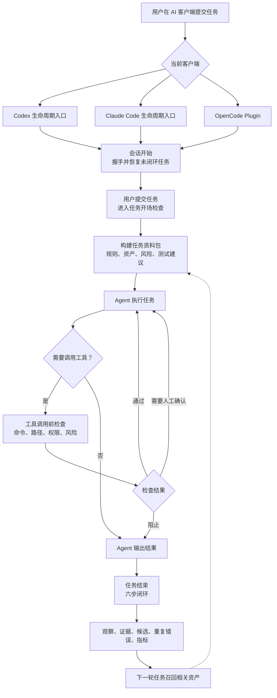
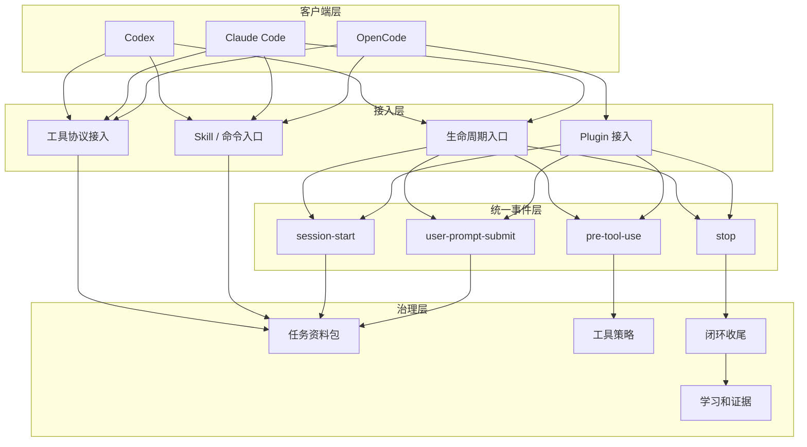
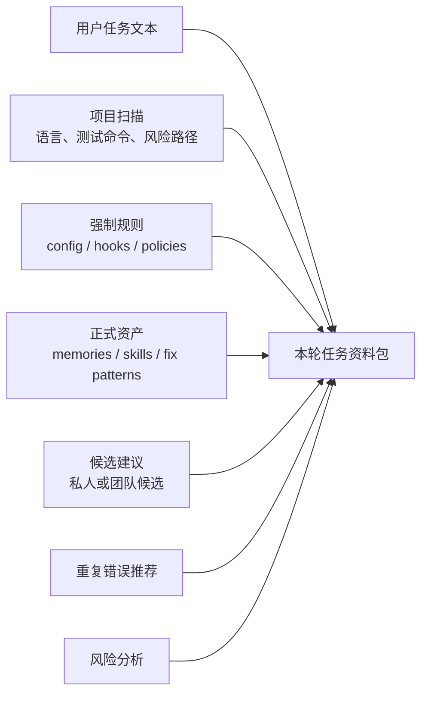
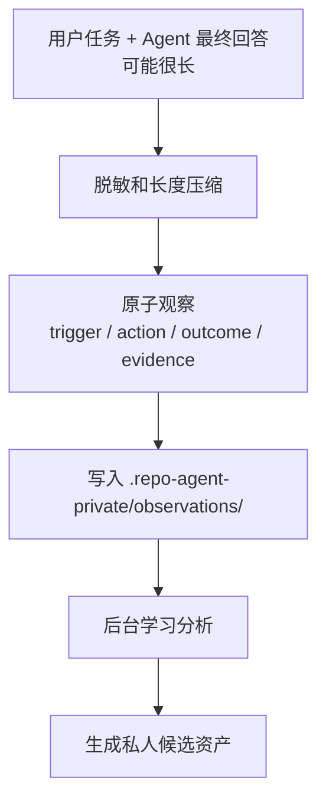
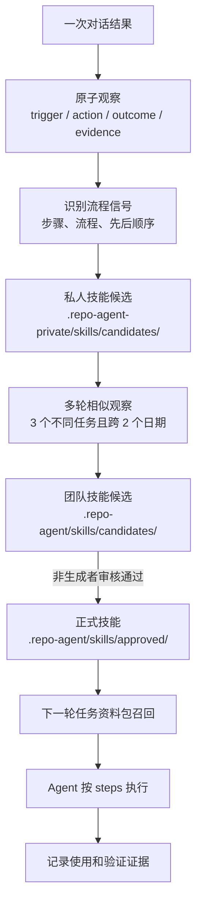
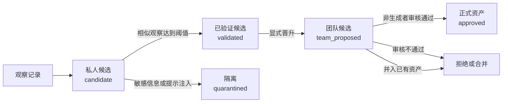
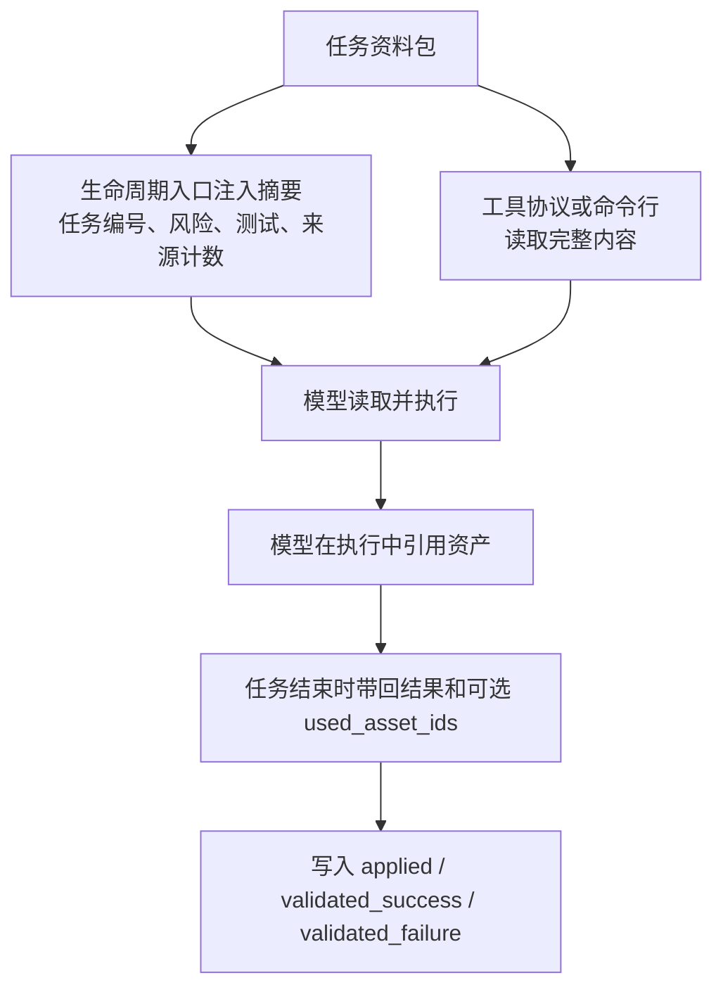
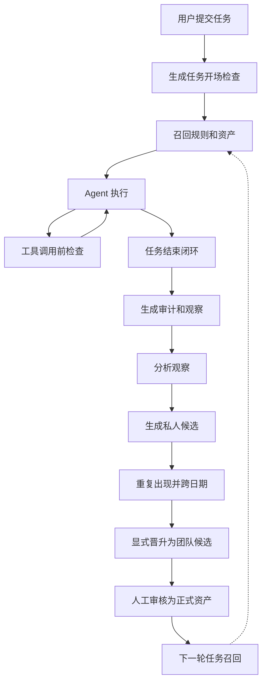

# 从安装后的项目看 repo-agent：一次 Agent 对话如何形成治理闭环

repo-agent 安装到项目后，会在项目内形成一套本地治理层，负责串联客户端接入、任务资料包、工具检查、任务收尾、资产沉淀和下一轮召回。

AI Coding 进入团队开发后，问题会集中在协作边界上：

- 团队成员使用不同客户端，项目规则容易散落在各自工具配置里。
- Agent 能直接改文件、跑命令、调用工具，越权操作和高风险路径需要稳定拦截。
- 项目约定、测试要求、安全边界经常只存在于文档或人的经验里，进入执行阶段后不够可靠。
- 一次对话结束后，过程、工具调用、验证结果和提交建议缺少统一记录。
- 有价值的经验留在聊天记录里，下一轮任务很难自动复用。
- 被沉淀的经验如果没有证据、权重和生命周期，时间久了会变成新的噪音。

repo-agent 对 AI Coding 的核心思考是：一次 Agent 对话应该被当作工程流程管理。任务开始前需要准备上下文，执行中需要检查工具和风险，结束后需要审计和验证，产生的经验需要先进入候选，再经过证据和人工审核成为团队资产。

下面从安装后的文件结构开始，按一次 Agent 对话的实际流转说明每类产物的来源、作用和生命周期。

## 1. 安装后项目里会出现什么

repo-agent 安装后的文件分为五类：

```mermaid
flowchart TB
  Root["项目根目录"]

  Package["repo-agent/<br/>离线运行包和 Skill"]
  Shared[".repo-agent/<br/>团队共享治理事实源"]
  Private[".repo-agent-private/<br/>个人本地学习、证据和候选"]
  Runtime[".repo-agent-runtime/<br/>当前会话运行状态"]
  Client["客户端接入配置<br/>Codex / Claude Code / OpenCode"]

  Root --> Package
  Root --> Shared
  Root --> Private
  Root --> Runtime
  Root --> Client

  Package --> Bundle["repo-agent.bundle.js<br/>项目内执行入口"]
  Package --> Skill["SKILL.md / 使用文档<br/>给 Agent 和人看的操作说明"]
  Package --> Schemas["schemas/<br/>配置和资产校验模式"]

  Shared --> Rules["config / policies / hooks<br/>团队规则和事件路由"]
  Shared --> Assets["memories / skills / fix_patterns<br/>已审核团队资产"]
  Shared --> Review["workflows / review_lenses / tools<br/>流程、审查视角和工具权限"]
  Shared --> TeamGenerated["generated/<br/>审计和派生产物"]

  Private --> Obs["observations/<br/>每轮对话压缩后的观察记录"]
  Private --> Cand["*_candidates/<br/>私人候选资产"]
  Private --> Evidence["evidence/<br/>证据账本和健康分"]
  Private --> LocalLearning["learning / lifecycle<br/>本地分析状态"]

  Runtime --> TaskFiles["preflights/<br/>本轮任务资料包"]
  Runtime --> Events["events/<br/>工具、上下文、闭环事件"]
  Runtime --> CloseFiles["closures / metrics<br/>闭环回执和指标"]

  Client --> Codex[".codex/config.toml<br/>.codex/hooks.json"]
  Client --> Claude[".mcp.json<br/>.claude/settings.json<br/>.claude/skills/repo-agent/"]
  Client --> OpenCode["opencode.json<br/>.opencode/plugins/repo-agent.js<br/>.opencode/skills/repo-agent/"]
```



对应文件结构：

```text
<project>/
├─ repo-agent/
│  ├─ repo-agent.bundle.js                 # 项目内运行入口，生命周期入口、命令行、工具协议共同调用
│  ├─ package.json                         # 离线包元数据
│  ├─ SKILL.md                             # 供支持 Skill 的 Agent 读取
│  ├─ 使用文档.md / README.md              # 给团队成员看的使用说明
│  ├─ schemas/                             # config、hook routes、candidate、skill 等校验模式
│  ├─ templates/                           # 初始化模板
│  ├─ references/command-map.md            # 命令映射说明
│  ├─ agents/openai.yaml                   # Skill 相关声明
│  ├─ scripts/install.mjs                  # 安装辅助脚本
│  ├─ VERSION / RELEASE-MANIFEST.json      # 版本和发布清单
│  └─ CHECKSUMS.txt                        # 离线包校验
│
├─ .repo-agent/
│  ├─ README.md                            # 安装后项目内说明
│  ├─ config.yaml                          # 项目级治理配置、预算、学习、生命周期策略
│  ├─ lock.yaml                            # repo-agent 资产版本和升级状态
│  ├─ commit_policy.yaml                   # 提交建议策略
│  ├─ hooks/routes.yaml                    # 会话开始、提交任务、工具调用前、任务结束的路由
│  ├─ policies/
│  │  ├─ command_policy.yaml               # 命令风险策略
│  │  ├─ permissions.yaml                  # 默认权限策略
│  │  └─ protected_files.yaml              # 受保护文件和路径
│  ├─ adapters/
│  │  ├─ codex.yaml                        # Codex 能力声明
│  │  ├─ claude-code.yaml                  # Claude Code 能力声明
│  │  └─ opencode.yaml                     # OpenCode 能力声明
│  ├─ tools/
│  │  ├─ registry.yaml                     # 工具清单、工具类型和风险
│  │  └─ permissions.yaml                  # 工具权限覆盖
│  ├─ workflows/
│  │  ├─ feature.yaml                      # 普通功能任务流程
│  │  ├─ bugfix.yaml                       # 缺陷修复任务流程
│  │  └─ security-change.yaml              # 安全相关任务流程
│  ├─ review_lenses/
│  │  ├─ security.yaml                     # 安全审查视角
│  │  ├─ testing.yaml                      # 测试审查视角
│  │  └─ database.yaml                     # 数据库审查视角
│  ├─ memories/                            # 已批准的团队记忆，Markdown 形式
│  ├─ skills/approved/                     # 已批准的团队技能，YAML 形式
│  ├─ skills/candidates/                   # 团队技能候选
│  ├─ fix_patterns/approved/               # 已批准的修复模式
│  ├─ fix_patterns/candidates/             # 团队修复模式候选
│  ├─ memory_candidates/                   # 团队记忆候选
│  ├─ learning_inbox/                      # 团队学习收件箱
│  ├─ catalog/                             # 资产索引
│  ├─ lifecycle_proposals/                 # 归档、删除、恢复提案
│  ├─ tombstones/                          # 已删除资产的墓碑记录
│  └─ generated/
│     ├─ init_report.md                    # 初始化报告
│     ├─ gitignore_suggestion.txt          # gitignore 建议
│     ├─ audits/                           # 每轮任务审计
│     ├─ recurring_errors/                 # 重复错误聚合
│     ├─ context_packs/                    # 可选上下文包导出
│     ├─ patches/                          # 补丁摘要
│     ├─ review_summaries/                 # 审查摘要
│     ├─ stale_candidates/                 # 陈旧资产分析
│     └─ tmp/                              # 临时文件
│
├─ .repo-agent-private/
│  ├─ observations/<project-id>/*.jsonl     # 每轮对话压缩后的原子观察
│  ├─ memory_candidates/                    # 私人记忆候选
│  ├─ skills/candidates/                    # 私人技能候选
│  ├─ fix_patterns/candidates/              # 私人修复模式候选
│  ├─ quarantine/                           # 含敏感内容或提示注入风险的隔离候选
│  ├─ learning_inbox/                       # 私人学习收件箱
│  ├─ evidence/events.jsonl                 # 证据事件，只追加
│  ├─ evidence/materialized.json            # 根据证据事件计算出的健康分
│  ├─ learning/last-analysis.json           # 后台学习上次分析位置
│  └─ lifecycle/thresholds.json             # 资产低健康分持续时间
│
├─ .repo-agent-runtime/
│  ├─ activation.json                       # 客户端接入状态，重开会话后生效
│  ├─ tools/<tool>.json                     # 当前工具握手状态
│  ├─ preflights/*.json                     # 每轮任务开场检查和任务资料包
│  ├─ preflights/sessions/<session>/latest.json
│  ├─ sessions/<session>/activities/        # 本轮显式活动记录
│  ├─ events/                              # 运行事件流
│  ├─ closures/                            # 闭环回执
│  └─ metrics/latest.json                  # 最新运行指标
│
├─ .codex/config.toml                       # Codex 工具协议接入配置
├─ .codex/hooks.json                        # Codex 生命周期入口
├─ .agents/skills/repo-agent/               # Codex 可读取的项目 Skill
├─ .mcp.json                                # Claude Code 工具协议接入配置
├─ .claude/settings.json                    # Claude Code 生命周期入口
├─ .claude/skills/repo-agent/               # Claude Code 可读取的项目 Skill
├─ opencode.json                            # OpenCode 工具协议和权限配置
├─ .opencode/plugins/repo-agent.js          # OpenCode 事件映射插件
├─ .opencode/skills/repo-agent/             # OpenCode 可读取的项目 Skill
└─ .opencode/commands/repo-agent.md         # OpenCode 命令入口
```

文件边界：

| 位置 | 主要内容 | 是否适合提交 | 作用 |
|---|---|---:|---|
| `repo-agent/` | 离线运行包、Skill、模式文件、使用说明 | 是 | 让项目自己带着 repo-agent 运行能力 |
| `.repo-agent/` | 团队治理规则、路由、正式资产、团队候选 | 视目录而定 | 团队共享事实源 |
| `.repo-agent-private/` | 个人观察、私人候选、证据账本 | 否 | 本地学习和验证沉淀 |
| `.repo-agent-runtime/` | 本轮对话运行状态、事件、闭环回执 | 否 | 当前会话的临时状态 |
| 客户端配置 | Codex / Claude Code / OpenCode 的接入文件 | 视团队约定 | 把不同工具接进同一套治理流程 |

## 2. 一次对话经过哪些阶段

无论团队成员使用 Codex、Claude Code 还是 OpenCode，进入项目后的流程都被归一成同一条链路：



每个阶段都有明确产物：

| 阶段 | 读取 | 写入 | 产物用途 |
|---|---|---|---|
| 会话开始 | 客户端配置、接入状态 | `.repo-agent-runtime/tools/<tool>.json` | 判断 repo-agent 是否已接入 |
| 用户提交任务 | `.repo-agent/config.yaml`、路由、策略、资产 | `.repo-agent-runtime/preflights/*.json` | 生成本轮任务身份和任务资料包 |
| 执行中工具检查 | 工具清单、权限、命令策略、保护路径 | `.repo-agent-runtime/events/` | 记录工具通过、确认或阻止 |
| 任务结束 | 本轮任务、变更、测试建议、最终回答 | 闭环回执、审计、观察、指标 | 保证任务有收尾证据 |
| 学习分析 | 观察记录、证据、重复错误 | 私人候选、团队候选、生命周期提案 | 让经验进入审核链路 |
| 下一轮召回 | 正式资产、候选建议、重复错误推荐 | 新的任务资料包 | 给下一个 Agent 使用 |

## 3. 多客户端兼容靠什么

团队成员可以使用不同 AI 客户端，但同一个项目的治理规则保持一致。

兼容方式分三层：



客户端差异停在接入层：

| 客户端 | 安装后接入文件 | 默认入口 | 进入 repo-agent 后 |
|---|---|---|---|
| Codex | `.codex/config.toml`、`.codex/hooks.json`、`.agents/skills/repo-agent/` | 生命周期入口 | 映射到统一生命周期事件 |
| Claude Code | `.mcp.json`、`.claude/settings.json`、`.claude/skills/repo-agent/` | 生命周期入口 | 映射到统一生命周期事件 |
| OpenCode | `opencode.json`、`.opencode/plugins/repo-agent.js`、`.opencode/skills/repo-agent/` | Plugin | 插件把 OpenCode 事件映射到统一生命周期事件 |

后续的任务资料包、工具检查、闭环收尾、资产沉淀都走同一套 `.repo-agent/` 规则。

## 4. 任务资料包如何生成

用户提交任务后，repo-agent 会生成一个任务开场检查编号，代码里叫 `preflight.<timestamp>.<tool>.<uuid>`。编号贯穿本轮对话：工具事件、审计、观察、证据和闭环回执都会关联到同一轮任务。

任务资料包的来源：



任务资料包按可信度分区：

| 分区 | 内容 | 模型应该如何使用 |
|---|---|---|
| 强制规则 | `config.yaml`、`hooks/routes.yaml`、`policies/*.yaml` | 必须遵守 |
| 可信资产 | 已批准的记忆、技能、修复模式 | 当作项目事实和可复用方法 |
| 未审核建议 | 候选资产 | 只能参考，不能覆盖强制规则和正式资产 |
| 重复错误推荐 | 历史重复失败信号 | 提醒本轮提前规避 |
| 风险和测试 | 风险等级、必须动作、推荐测试 | 决定执行边界和验证方式 |

生命周期入口注入给客户端的文本会保持简短，只说明本轮任务编号、风险、必须动作、推荐测试、闭环活动，以及已注入哪些来源。完整任务资料包可以通过工具协议或命令行读取，例如 `get_latest_preflight`、`get_context_pack`、`context`。

## 5. 从一段长对话里提炼资产

一次 Agent 对话可能有 1000 字甚至更多。repo-agent 不保存完整长回答作为团队经验。任务结束时，repo-agent 会先压缩出一条结构化观察。



观察记录只保留对后续有用的结构化信息：

| 字段 | 作用 |
|---|---|
| `trigger` | 本轮任务触发点，来自用户任务，限制长度并脱敏 |
| `action` | Agent 最终结果摘要，限制长度并脱敏 |
| `outcome` | 成功、失败或部分完成 |
| `kind` | 观察类型，用于后续分流 |
| `changedFiles` | 本轮涉及的文件 |
| `tests` | 本轮推荐或执行的测试 |
| `auditId` | 对应审计记录 |
| `preflightId` / `sessionId` | 关联本轮任务和会话 |

压缩规则很朴素：

- Markdown 链接会去掉 URL，只保留文字。
- 连续空白会合并。
- `trigger` 默认最多 240 字。
- `action` 默认最多 480 字。
- 尽量在句号、问号、分号、空格等自然边界截断。
- 检测到敏感信息时标记为已脱敏。

压缩后的观察记录保留四类信息：触发原因、执行动作、执行结果、证据位置。

## 6. 资产如何分类与沉淀

资产分类发生在观察记录之后。repo-agent 有两条学习入口。

第一条是任务结束后的自动观察。观察会先分成这些类型：

| 观察类型 | 典型内容 | 后续候选类型 |
|---|---|---|
| `failed_attempt` | 本轮失败或出现错误 | 修复模式候选 |
| `repeated_workflow` | 先做什么、再做什么的稳定流程 | 技能候选 |
| `project_convention` | 项目约定、测试映射、踩坑 | 记忆候选 |
| `security_boundary` | 安全边界、禁止行为 | 通常进入记忆或后续人工处理 |
| `correction` | 用户纠正了 Agent 行为 | 记忆候选 |
| `successful_resolution` | 成功解决问题但未命中更细分类 | 记忆候选 |

第二条是显式学习收件箱或 `classify_learning`。这类入口会根据文本内容建议更细的目标：

| 文本信号 | 建议目标 | 是否自动写成候选 |
|---|---|---:|
| 业务规则、需求规范 | 规格候选 | 否 |
| 架构、技术选型 | 架构决策候选 | 否 |
| 安全边界、禁止行为 | 策略候选 | 否 |
| 步骤、流程、先后顺序 | 技能候选 | 是 |
| 错误和修复方法 | 修复模式候选 | 是 |
| 项目约定、测试映射、踩坑 | 记忆候选 | 是 |
| 没有长期价值 | 仅记录轨迹 | 否 |

分流规则会把不同内容放入不同资产类型。流程进入技能，错误进入修复模式，项目约定进入记忆，策略和架构类内容需要更强审核。

| 资产类型 | 适合沉淀的内容 | 正式资产位置 | 后续使用方式 |
|---|---|---|---|
| 记忆 Memory | 项目约定、测试映射、踩坑、安全注意事项 | `.repo-agent/memories/*.md` | 帮助 Agent 理解项目事实和局部约束 |
| 技能 Skill | 可重复执行的流程、固定步骤、标准操作路径 | `.repo-agent/skills/approved/*.yaml` | 给 Agent 提供可执行步骤 |
| 修复模式 Fix Pattern | 错误特征、根因、修复建议、回归要求 | `.repo-agent/fix_patterns/approved/*.yaml` | 帮助 Agent 遇到同类问题时快速定位处理方式 |
| 规格 / 架构 / 策略 | 业务规则、架构决策、安全边界 | 后续人工处理或更强审核入口 | 不直接作为普通候选自动写入 |

### Skill：流程类资产的沉淀示例

Skill 在 repo-agent 中分为两类：

| 类型 | 位置 | 作用 |
|---|---|---|
| repo-agent 接入 Skill | `repo-agent/SKILL.md`、`.agents/skills/repo-agent/`、`.claude/skills/repo-agent/`、`.opencode/skills/repo-agent/` | 让支持 Skill 的客户端知道如何调用 repo-agent |
| 团队沉淀技能资产 | `.repo-agent-private/skills/candidates/`、`.repo-agent/skills/candidates/`、`.repo-agent/skills/approved/` | 把项目里重复出现的工作流程沉淀成可复用步骤 |

团队沉淀技能资产来自流程类观察。一次任务结束后，如果观察记录包含稳定的先后顺序，例如“先运行失败测试，再实施最小修复，最后运行完整回归”，会进入技能候选链路。



技能候选的判断信号：

| 来源 | 命中内容 | 结果 |
|---|---|---|
| 任务结束观察 | `repeated_workflow` | 生成技能候选 |
| 显式学习分类 | `first`、`then`、`finally`、`steps`、`workflow`、`process`、`先...再`、`步骤`、`流程` | 生成技能候选 |

技能候选文件会包含：

| 字段 | 含义 |
|---|---|
| `description` | 对流程的简短描述 |
| `steps` | 可执行步骤数组 |
| `evidence` | 来源任务、出现次数、关联任务、测试和审计 |
| `score.final_weight` | 候选排序权重，初始为 `0.3` |
| `trusted` | 候选阶段为 `false` |
| `review` | 审核要求和审核记录 |

审核通过后，正式技能写入 `.repo-agent/skills/approved/<id>.yaml`。正式技能必须包含非空 `steps`，形态如下：

```yaml
id: skill.learned.example
version: 1
status: approved
title: 先运行失败测试，再实施最小修复，最后运行完整回归
steps:
  - 先运行失败测试
  - 实施最小修复
  - 运行完整回归
approved_at: 2026-07-09T00:00:00.000Z
approved_by: reviewer
```

下一轮任务开始时，repo-agent 会读取 `.repo-agent/skills/approved/`，把 `title`、`description`、`steps` 等内容参与相关度计算。技能默认权重是 `0.8`，默认最多召回 4 条。命中当前任务后，技能进入任务资料包的可信资产分区。

Agent 使用技能时，拿到的是一组可执行步骤。任务结束时，如果 Agent 上报 `used_asset_ids`，repo-agent 会为对应技能记录 `applied`；任务成功或失败时继续记录 `validated_success` 或 `validated_failure`。只被召回会记录 `retrieved`，不会提高技能质量。

## 7. 候选资产怎样产生

候选资产默认先写到私人目录：

```text
.repo-agent-private/memory_candidates/
.repo-agent-private/skills/candidates/
.repo-agent-private/fix_patterns/candidates/
```

候选文件包含这些信息：

| 字段 | 含义 |
|---|---|
| `id` | 资产目标标识，例如 `memory.learned.<hash>` |
| `candidate_id` | 候选文件唯一标识 |
| `status` | `candidate`、`validated`、`team_proposed`、`approved` 等状态 |
| `trusted` | 候选阶段固定为 `false` |
| `type` | `memory`、`skill`、`fix_pattern` |
| `content` / `steps` / `pattern` | 资产正文，随类型不同 |
| `evidence` | 来源任务、出现次数、关联任务、测试、审计 |
| `review` | 审核要求、审核人、审核时间 |
| `score` | 候选初始评分 |
| `base_revision` | 如果目标正式资产已存在，记录当时的基线版本 |

候选初始分数：

```text
confidence = 0.5
usefulness = 0.5
freshness = 1
recurrence = 0
success_rate = 0
final_weight = 0.3
```

候选内容会先做安全检查：

- 内容为空会拒绝。
- 疑似密钥会拒绝写入。
- 疑似提示注入、绕过规则、读取密钥的文本会进入隔离区。
- 同一可见范围内，相同 `id` 的活跃候选不能重复创建。
- 文件名由内容指纹生成，避免多人生成时互相覆盖。

## 8. 候选资产怎样晋级

一次观察形成候选，只说明“可能有价值”。repo-agent 需要多轮证据来降低偶然性。



后台学习会把相似观察聚合。相似度使用词项重合、中文二元/三元词组和结构匹配，阈值是 `0.82`。

默认晋级依据：

| 条件 | 默认值 | 作用 |
|---|---:|---|
| 不同任务开场检查数量 | 3 | 避免同一轮对话重复刷高 |
| 覆盖日期数量 | 2 | 避免同一天偶然结果直接晋级 |
| 是否有证据 | 文件、测试或审计任一类 | 后台分析会据此标记可晋升 |
| 私人候选晋升 | 显式执行 `candidate promote` | 写入 `.repo-agent/*/candidates/` |
| 团队候选批准 | 非生成者审核 | 写入正式资产目录 |

当前实现里，`candidate promote` 的硬检查是：至少 3 个不同任务开场检查，并覆盖 2 个日期。后台分析会根据文件、测试或审计证据标记 `promotion_eligible`，供人工判断。

私人候选不能直接批准。团队候选也不能由生成者自己批准。由 Agent 总结出的经验，需要经过人工判断后再进入团队事实源。

批准后写入位置：

| 类型 | 正式资产位置 | 形态 |
|---|---|---|
| 记忆 | `.repo-agent/memories/<scope>.md` | Markdown |
| 技能 | `.repo-agent/skills/approved/<id>.yaml` | YAML，包含步骤 |
| 修复模式 | `.repo-agent/fix_patterns/approved/<id>.yaml` | YAML，包含错误模式和处理建议 |

## 9. 权重如何上升或衰减

repo-agent 里有两类分数，不能混在一起。

第一类是候选资产分数，主要用于候选建议排序。候选创建时 `final_weight=0.3`。重复学习的更新路径会按出现次数提高分数：

```text
confidence   = min(0.95, 0.5 + occurrences × 0.05)
usefulness   = min(0.90, 0.5 + occurrences × 0.04)
final_weight = min(0.80, 0.3 + occurrences × 0.05)
```

第二类是正式资产的生命周期健康分。健康分不靠“被看见”变高，主要靠真实使用和验证结果。

证据事件类型：

| 类型 | 含义 | 是否提高质量 |
|---|---|---:|
| `retrieved` | 资产被召回进本轮任务资料包 | 否 |
| `applied` | Agent 明确使用了这个资产 | 作为使用证据 |
| `validated_success` | 使用后任务成功 | 是 |
| `validated_failure` | 使用后任务失败 | 会拉低质量 |
| `contradicted` | 被发现与事实冲突 | 会产生惩罚 |
| `review_approved` | 人工审核认可 | 增加审核信任 |

健康分计算：

```text
Freshness = 0.5 ^ (ageDays / freshnessHalfLifeDays)

DistinctUseScore = 1 - exp(-distinctValidatedUse / 8)

ContradictionPenalty = min(0.6, contradictedCount × 0.15)

Health =
  0.40 × QualityLowerBound
+ 0.25 × DistinctUseScore
+ 0.20 × Freshness
+ 0.15 × ReviewTrust
- ContradictionPenalty
```

其中：

- `freshnessHalfLifeDays` 默认是 180 天。
- `QualityLowerBound` 使用 Beta 后验下界，避免少量成功导致分数虚高。
- `distinctValidatedUse` 按不同任务计算，防止同一任务重复计数。
- `ReviewTrust = min(1, review_approved 次数)`。
- 没有应用记录的资产会按较老的时效处理。

生命周期策略会使用健康分：

| 健康状态 | 默认策略 |
|---|---|
| 低于 `0.45` 持续 90 天 | 标记为陈旧资产 |
| 低于 `0.30` 持续 180 天 | 生成归档提案 |
| 已归档且有替代资产，继续满足条件 | 生成删除提案 |
| 需要恢复 | 生成恢复提案 |

团队正式资产不会被系统静默删除。系统只能生成提案，实际变更需要审核。

## 10. 召回如何命中

任务资料包会从正式资产和候选建议中选择与当前任务相关的内容。

召回分两步：先算相关度，再算排序分。

相关度使用离线信号，不依赖网络：

```text
Relevance =
  min(1,
    0.55 × BM25
  + 0.35 × Jaccard
  + 0.10 × EntityMatch
  )
```

信号来源：

| 信号 | 说明 |
|---|---|
| 英文和数字词元 | 按非字母数字切分，长度至少 3 |
| 中文词组 | 提取连续中文的二元和三元词组 |
| BM25 | 看任务词在资产内容中的词频和长度归一化 |
| Jaccard | 看任务和资产词集合的重合比例 |
| EntityMatch | 路径、文件名、类名、配置名等实体命中 |

排序分：

```text
Rank =
  0.55 × Relevance
+ 0.20 × Quality
+ 0.10 × Freshness
+ 0.10 × ScopeMatch
+ 0.05 × Diversity
```

当前实现里：

- `min_relevance` 默认是 `0.15`。
- 相关度为 0 的资产不会召回。
- memory 默认权重是 `0.7`。
- skill 默认权重是 `0.8`。
- fix pattern 默认权重是 `0.7`。
- 候选建议默认最多召回 1 条。
- 候选建议始终标记为不可信。
- 正式资产会做去重，内容相似度过高的只保留一个。
- 超出上下文预算时，裁剪顺序是候选建议、修复模式、技能、记忆。
- 强制规则不会因为预算被裁剪。

召回成功时，repo-agent 会写一条 `retrieved` 证据。该证据只说明本轮任务看到了这个资产，不说明资产已经被验证有效。

## 11. 召回资产如何注入上下文

任务资料包最后会进入当前客户端能理解的入口。



模型实际看到的是分区后的内容：

| 分区 | 使用方式 |
|---|---|
| 强制规则 | 作为硬约束，优先级最高 |
| 已批准记忆 | 提供项目事实、约定、测试映射和注意事项 |
| 已批准技能 | 提供可执行 `steps`，指导 Agent 按流程处理任务 |
| 已批准修复模式 | 提供错误特征、处理建议和回归要求 |
| 未审核建议 | 只能作为提醒，需要自行核对 |
| 重复错误推荐 | 提醒本轮可能遇到的历史问题 |
| 推荐测试 | 决定本轮验证命令 |
| 风险和必须动作 | 决定是否需要确认、是否必须运行测试 |

Agent 在任务结束时提供 `used_asset_ids` 后，repo-agent 会把这些资产记为 `applied`；如果本轮结果是成功或失败，还会写入 `validated_success` 或 `validated_failure`。

repo-agent 分开记录“被召回”和“被证明确实有用”。只被召回不会让资产质量上升。

## 12. 从一次对话到下一次对话的闭环

完整闭环：



闭环中的控制点：

1. 原始对话先变成结构化观察，不直接变成正式资产。
2. 候选资产需要重复出现、跨任务、跨日期，并经过晋升和审核。
3. 资产被下一轮召回后，还要通过应用和验证证据持续更新健康状态。

## 13. 任务结束时的六步闭环

`.repo-agent/hooks/routes.yaml` 里声明了任务结束后的闭环步骤：

```yaml
closure_steps:
  - commit_advice
  - audit_recorded
  - observation_captured
  - recurring_analyzed
  - lifecycle_evaluated
  - metrics_updated
```

对应产物：

| 步骤 | 产物 | 作用 |
|---|---|---|
| `commit_advice` | 提交建议 | 判断是否建议提交、拆分提交或暂不提交 |
| `audit_recorded` | `.repo-agent/generated/audits/` | 记录任务、结果、使用资产、变更和测试 |
| `observation_captured` | `.repo-agent-private/observations/` | 把长对话压缩成原子观察 |
| `recurring_analyzed` | `.repo-agent/generated/recurring_errors/`、学习收件箱 | 发现重复错误并提出后续学习入口 |
| `lifecycle_evaluated` | 私人候选、生命周期提案、健康分 | 分析资产是否可晋级、陈旧或需要清理 |
| `metrics_updated` | `.repo-agent-runtime/metrics/latest.json` | 记录本轮任务指标 |

如果闭环没有完成，repo-agent 会阻止任务安静结束，要求恢复或补齐闭环。

## 14. Agent 工程设计原则

repo-agent 体现的是一套 Agent 友好型项目设计方法。

第一，项目需要有机器可执行的规则入口。说明文档适合给人看，工具调用、路径保护、任务收尾需要进入生命周期入口、项目插件、工具协议或类似的执行入口。

第二，上下文需要分区。强制规则、可信资产、候选建议、重复错误、测试建议不能混成一段提示词。分区后，模型才知道哪些内容必须遵守，哪些内容只能参考。

第三，经验需要有来源和晋级路径。一次对话生成观察，观察生成候选，候选经过重复验证和人工审核，最后才成为团队资产。

第四，召回需要可解释。命中原因、相关度、权重、预算裁剪和证据事件都能追踪，团队可以看到某条经验进入本轮上下文的依据。

第五，资产需要生命周期。长期不用、验证失败、被事实矛盾的资产应该降权、归档或删除；仍然有效的资产会靠成功证据保持健康。

## 15. 实现依据

实现位置：

| 主题 | 实现位置 |
|---|---|
| 初始化安装后目录和默认文件 | `src/commands/init.ts` |
| 客户端能力和接入配置 | `src/adapters/types.ts`、`src/adapters/registry.ts`、`src/core/integration-manager.ts`、`src/core/opencode-plugin.ts` |
| 生命周期事件和任务开场检查 | `src/core/hook-runtime.ts`、`src/core/hook-router.ts` |
| 任务资料包构建 | `src/core/context-builder.ts` |
| 资产读取、相关度和排序 | `src/core/asset-reader.ts` |
| 工具策略 | `src/core/policy-engine.ts`、`src/core/tool-manifest.ts` |
| 观察记录 | `src/core/observation-manager.ts` |
| 学习分流 | `src/core/learning-router.ts`、`src/core/learning-inbox.ts` |
| 候选资产、晋升和审核 | `src/core/candidate-manager.ts` |
| 证据账本和健康分 | `src/core/evidence-manager.ts` |
| 生命周期提案 | `src/core/asset-lifecycle.ts` |
| 闭环状态机 | `src/core/closure-engine.ts`、`src/core/event-store.ts` |
| 工具协议入口 | `src/mcp/server.ts`、`src/mcp/tools.ts` |
