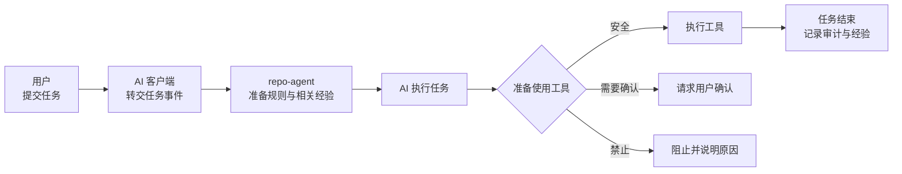
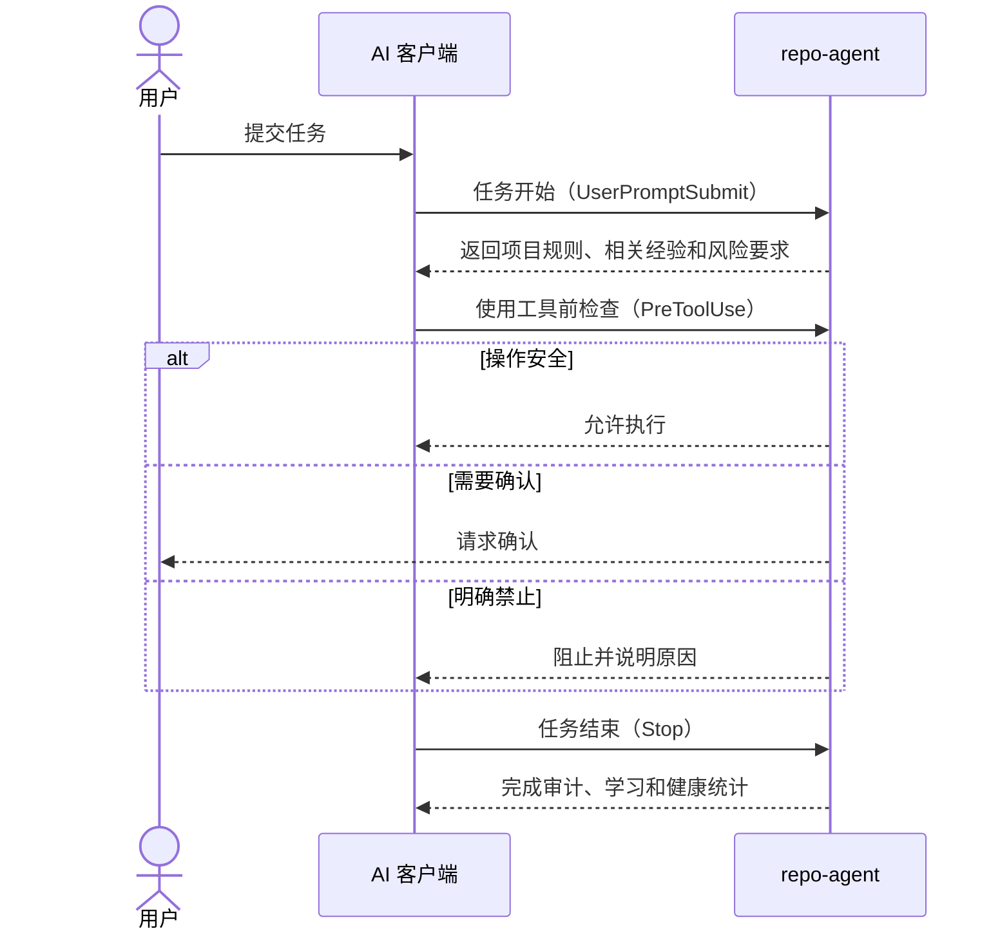
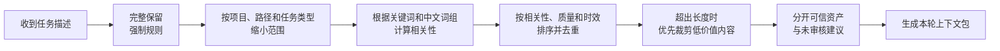
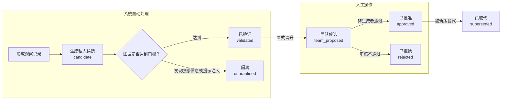
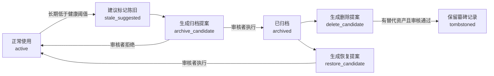

# repo-agent 使用文档（1.0.0）

## 阅读说明

这份文档面向 repo-agent 的安装者和日常使用者。阅读时遵循两个原则：

- 中文名称解释概念，例如“任务前置检查”；括号中的英文名称或代码值用于查日志、配置和源码。
- 命令、文件名、配置字段和状态值必须保持原样，不应自行翻译。

如果只是使用 repo-agent，优先阅读安装、团队同步、状态排障和验收清单。自动学习、证据和生命周期章节主要用于理解治理结果。

一次任务的基本过程如下：



## 1. 运行前提

- Windows、macOS 或 Linux。
- Node.js 18 或更高版本。
- 离线包 `repo-agent-node-offline.zip`。
- 命令在目标项目根目录执行。

repo-agent 默认离线运行。它会根据任务中的关键词、中文词组、文件范围和历史质量，从本地选择相关规则与经验，不依赖外部模型。具体算法见详细设计方案。

## 2. 安装

### 2.1 解压

macOS/Linux：

```bash
unzip repo-agent-node-offline.zip
```

Windows PowerShell：

```powershell
Expand-Archive .\repo-agent-node-offline.zip -DestinationPath .
```

解压后目录必须为：

```text
项目根/
  repo-agent/
    repo-agent.bundle.js
    CHECKSUMS.txt
    RELEASE-MANIFEST.json
    VERSION
```

### 2.2 一条命令初始化

团队项目：

```bash
node repo-agent/repo-agent.bundle.js init --mode team --tool all --entry auto
```

个人项目：

```bash
node repo-agent/repo-agent.bundle.js init --mode personal --tool all --entry auto
```

`init` 会创建 `.repo-agent/`、工具接入配置和 `.gitignore` 托管区块。它不会创建或修改 `AGENTS.md`、`CLAUDE.md`。

配置更新后，Codex、Claude Code、OpenCode 需要新建会话或重新打开工具；无需重启业务项目。

### 2.3 使用 Skill 安装

离线包中的 `repo-agent/` 同时是标准 Agent Skill。将它交给支持 Agent Skills 的客户端或比赛平台加载后，可以通过交互入口安装：

| 客户端 | 调用方式 | 安装后的项目入口 |
|---|---|---|
| Codex | `$repo-agent` 或 `/skills` | `.agents/skills/repo-agent/` |
| Claude Code | `/repo-agent` | `.claude/skills/repo-agent/` |
| OpenCode | 首次加载 Skill；安装后使用 `/repo-agent` | `.opencode/skills/repo-agent/`、`.opencode/commands/repo-agent.md` |

Skill 会依次收集项目模式、目标客户端和接入方式，先执行安装预演，展示实际命令与影响；确认后校验安装包的 `CHECKSUMS.txt`，把运行文件复制到目标项目的 `repo-agent/`，并调用现有 `init`。如果目标已经存在 `repo-agent/`，Skill 不会覆盖，而是引导执行 `update`。

Skill 只是交互入口，所有行为仍由 `repo-agent.bundle.js` 实现。直接执行 Node.js 命令与使用 Skill 的结果一致。

### 2.4 配置约束

`.repo-agent/config.yaml` 只暴露运行时真实消费的字段：

- `network`、`audit`、`context`
- `recurring_error_policy`、`automatic_growth_policy`
- `asset_lifecycle_policy`、`closure_policy`、`evidence_policy`

严格校验（`validate --strict`）会拒绝未知字段。项目语言、框架和测试命令由运行时扫描，不需要复制到配置；执行环境由每次上下文包（ContextPack）请求传入。

## 3. 团队同步与升级

拉取新的团队资产或收到升级包时统一执行：

```bash
node repo-agent/repo-agent.bundle.js update
```

`update` 自动判断走向：无升级包时校验团队资产，修复 repo-agent 管理的钩子、项目插件、模型上下文协议和审批配置；检测到 `release/repo-agent-node-offline.zip` 或本地 `repo-agent/` 有更新版本时，读取迁移链、生成计划、备份并应用安全增量。命令幂等，可反复执行。加 `--dry-run` 预演、`--yes` 免确认、`--source <zip|dir>` 显式指定升级包、`--rollback [runId]` 回滚最近一次升级。

## 4. 工具接入

| 工具 | 自动接入方式 | 是否支持模型上下文协议 | 默认接入值 |
|---|---|---:|---|
| Codex | 原生钩子 | 支持 | `hook` |
| Claude Code | 原生钩子 | 支持 | `hook` |
| OpenCode | 项目插件 | 支持 | `plugin` |

常用命令：

```bash
node repo-agent/repo-agent.bundle.js activate --tool all --entry auto
node repo-agent/repo-agent.bundle.js deactivate --tool all
node repo-agent/repo-agent.bundle.js handshake --tool auto
```

`deactivate` 只移除 repo-agent 管理的钩子、项目插件、模型上下文协议和工具审批项；其他客户端配置保持不变。

### 4.1 交互式控制中心

项目初始化后，repo-agent Skill 提供以下用户菜单：

1. 更新或修复接入。
2. 查看状态，执行严格校验、环境诊断和健康检查。
3. 管理 AI 客户端接入、握手和解除接入。
4. 查看、晋升、批准、拒绝、归档或合并经验候选。
5. 分析重复错误并生成修复模式提案。
6. 解释证据和当前任务上下文。
7. 查看闭环状态或恢复失败闭环。
8. 生成、审核或恢复生命周期提案。

没有指定操作时显示菜单；例如 `$repo-agent 更新` 或 `/repo-agent 健康检查` 会直接进入相应流程。客户端支持结构化选择器时使用选择器，否则显示编号菜单。

查询操作在用户选择后直接执行。写操作必须先运行 `--dry-run`，展示实际命令和影响并取得确认；经验审核和生命周期应用还必须提供审核者名称。Skill 不提供构建、打包、发布、权限绕过或直接删除项目数据的功能。

### 4.2 工具清单与审批

repo-agent 使用一份工具清单（Tool Manifest）统一声明内置工具的名称、输入格式、副作用、风险和默认审批方式，避免多个配置互相冲突。

审批规则按下表从上到下匹配，越靠前优先级越高：

| 优先级 | 规则 | 结果 |
|---:|---|---|
| 1 | 明确禁止的危险操作 | 直接阻止 |
| 2 | 项目额外收紧的规则 | 阻止或请求确认 |
| 3 | 工具清单中的默认审批方式 | 自动放行或请求确认 |
| 4 | 未知的外部工具 | 交给 AI 客户端决定 |

- 查询类工具由 Codex 配置为 `approval_mode = "approve"`。
- 候选资产、审计和恢复等写入类工具使用客户端原生审批。
- `.repo-agent/tools/registry.yaml` 只登记外部工具或项目级收紧覆盖。
- `.repo-agent/tools/permissions.yaml` 可追加阻断或确认要求，不能绕过工具清单中的高风险默认值。
- 未在工具清单声明的 `mcp__repo_agent__*` 工具直接阻断，防止版本漂移或伪造。

Codex 的审批写入 `.codex/config.toml`：repo-agent 服务端默认为 `prompt`，安全工具逐项设为 `approve`。Claude Code 的写入类工具由原生钩子返回 `ask`。OpenCode 在 `opencode.json` 中将有副作用的 repo-agent 工具设置为 `ask`，已有 `deny` 不会被放宽。`update` 会修复托管配置；变化后必须新建工具会话。

## 5. 自动闭环

Codex 和 Claude Code 通过原生钩子把会话事件交给 repo-agent：



各事件的职责：

1. 会话开始（`SessionStart`）：检查接入状态，并恢复当前会话最近一次未完成的收尾任务。
2. 用户提交任务（`UserPromptSubmit`）：生成任务前置检查（Preflight）和上下文包；创建新任务前先恢复同一会话的旧任务。
3. 使用工具前（`PreToolUse`）：检查命令、路径和工具权限；危险操作直接阻止，需要确认的操作交给客户端审批。
4. 任务停止（`Stop`）：依次完成六个内部步骤：
   `commit_advice`、`audit_recorded`、`observation_captured`、
   `recurring_analyzed`、`lifecycle_evaluated`、`metrics_updated`。

重复触发任务停止事件不会重复生成审计、观察记录或证据。并发收尾会按任务前置检查加锁并依次执行。失败时只重试未完成步骤；24 小时未完成会标记为 `abandoned`。

OpenCode 使用名称不同但含义相同的事件：

| OpenCode 事件 | repo-agent 统一事件 | 中文含义 |
|---|---|---|
| `session.created` | `session-start` | 会话开始 |
| `chat.message` | `user-prompt-submit` | 用户提交任务 |
| `tool.execute.before` | `pre-tool-use` | 使用工具前 |
| `session.idle` | `stop` | 本轮任务结束 |

项目插件会在 `chat.message` 中把任务前置检查追加到当前消息，在工具执行前实施阻断，并在 `session.idle` 时完成六步收尾。OpenCode 的空闲事件不能强制模型继续运行；收尾失败时会保留回执（Receipt），并在同一会话的下一条消息开始前恢复。

检查和恢复：

```bash
node repo-agent/repo-agent.bundle.js closure status
node repo-agent/repo-agent.bundle.js closure recover --session-id <session-id>
node repo-agent/repo-agent.bundle.js closure recover --session-id <session-id> --dry-run
```

## 6. 上下文检索

repo-agent 会从本地资产中选择当前任务真正需要的内容：



默认排序：

```text
Rank =
  0.55 × Relevance
+ 0.20 × Quality
+ 0.10 × Freshness
+ 0.10 × ScopeMatch
+ 0.05 × Diversity
```

默认最低相关度 `min_relevance=0.15`。相关性为零的资产不会进入上下文包。强制策略始终完整保留；已批准资产默认使用摘要；未审核的候选资产最多提供一条。

上下文包分区：

- `mandatoryInstructions`：完整且可信的强制策略。
- `trustedAssets`：已批准的记忆、技能和修复模式。
- `untrustedAdvisories`：未批准的候选建议，只供参考，不作为系统指令。

手工检查：

```bash
node repo-agent/repo-agent.bundle.js context "任务描述"
node repo-agent/repo-agent.bundle.js explain context "任务描述"
```

内部长度预算采用近似词元（Token）估算：

```text
CJK Token = CJK 字符数
Latin Token = ceil(拉丁及数字字符数 / 4)
Final = ceil((CJK Token + Latin Token + JSON 开销) × 1.2)
```

超出预算时，依次裁剪候选建议、低相关修复模式、技能和记忆；强制策略不裁剪。

## 7. 自动学习

任务结束时，repo-agent 只生成一条结构化的原子观察（Atomic Observation），不会把 AI 的完整回答直接保存为技能。

本地存储：

```text
.repo-agent-private/observations/<project-id>/*.jsonl
```

后台分析触发条件：

- 新增观察记录达到 `background_observation_threshold`（默认 20）；
- 最旧未分析数据达到 `background_max_age_hours`（默认 24 小时）；
- 显式执行：

```bash
node repo-agent/repo-agent.bundle.js learning analyze
node repo-agent/repo-agent.bundle.js maintain
```

经验从产生到成为团队正式资产，需要经过系统验证和人工审核：



规则：

- 1 条完整观察记录可以形成私人候选。
- 达到 `validated_preflights` 和 `validated_days`（默认 3 个不同任务、跨 2 个日期）后成为已验证候选。
- 具备文件、测试或审计证据后才允许晋升。
- 同一会话中的重复记录，只按不同任务前置检查计算。
- 包含提示注入的候选会自动进入私人隔离区。
- 私人候选不能直接批准，团队候选必须由非生成者审核。
- 已批准资产永远不会由系统自动生成。

晋升与审核：

```bash
node repo-agent/repo-agent.bundle.js candidate promote <candidate-id>
node repo-agent/repo-agent.bundle.js skill approve <candidate-id> --reviewer <name>
node repo-agent/repo-agent.bundle.js memory reject <candidate-id> --reviewer <name>
```

## 8. 证据和健康分

证据账本（Evidence Ledger）：

```text
.repo-agent-private/evidence/events.jsonl
.repo-agent-private/evidence/materialized.json
```

事件类型：

```text
retrieved
applied
validated_success
validated_failure
contradicted
review_approved
```

召回 `retrieved` 不提高质量。只有明确标记为已应用的资产才能获得结果证据；`partial` 不增加成功或失败。

生命周期健康分：

```text
Health =
  0.40 × QualityLowerBound
+ 0.25 × DistinctValidatedUse
+ 0.20 × Freshness
+ 0.15 × ReviewTrust
- ContradictionPenalty
```

- 质量分使用 Beta 后验下界，避免少量成功记录造成虚高。
- 使用次数按不同任务计算。
- 时效性半衰期为 180 天。
- 当前检索排名只决定本轮是否选中；生命周期健康分决定资产是否长期保留。

解释：

```bash
node repo-agent/repo-agent.bundle.js evidence explain <asset-id>
```

## 9. 重复错误

只统计有失败证据且来自不同任务的问题：

- 2 次：进入观察状态和私人收件箱。
- 3 次：可以生成团队修复模式候选。
- 5 次：稳定流程可以生成团队技能候选。
- 高风险问题的阈值减半，但仍不得少于 2 个不同任务。

成功、部分完成、普通讨论、没有失败证据的收件箱记录、同一任务内的重复记录，以及已被正式修复模式完整覆盖的问题，都不计入重复错误。

```bash
node repo-agent/repo-agent.bundle.js recurring-errors analyze
node repo-agent/repo-agent.bundle.js recurring-errors list
node repo-agent/repo-agent.bundle.js recurring-errors recommend --task "任务"
node repo-agent/repo-agent.bundle.js recurring-errors propose-fix-pattern <recurring-id>
```

## 10. 生命周期

私人资产：

- 180 天无活动自动清理。
- `in_review`、`manual_hold` 和引用中的条目不清理。
- 清理只写本地报告，不影响 Git。

团队资产不会被系统直接删除。系统只能提出建议，审核者决定是否执行：



默认阈值：

- Health（健康分） `<0.45` 持续 90 天：建议标记陈旧。
- Health（健康分） `<0.30` 持续 180 天：生成归档提案。
- 已归档 180 天、无人引用且存在替代资产：生成删除提案。

任务结束事件和 `maintain` 只生成提案，不移动或删除团队已批准资产。策略、安全规则、工作流和审查视角属于永久保护资产；没有替代资产时禁止删除。

```bash
node repo-agent/repo-agent.bundle.js lifecycle propose
node repo-agent/repo-agent.bundle.js lifecycle list
node repo-agent/repo-agent.bundle.js lifecycle apply <proposal-id> --reviewer <name>
node repo-agent/repo-agent.bundle.js lifecycle restore <asset-id>
```

恢复操作会先生成恢复提案，再由审核者执行；不会因为单次关键词匹配而自动恢复。

## 11. 状态与排障

```bash
node repo-agent/repo-agent.bundle.js status
node repo-agent/repo-agent.bundle.js validate --strict
node repo-agent/repo-agent.bundle.js doctor
node repo-agent/repo-agent.bundle.js health check --deep --json
```

`status` 分别显示私人候选、团队候选、隔离候选、学习收件箱、闭环状态、生命周期提案，以及构建产物、钩子、模型上下文协议、模式约束和模板版本。

`health check --deep` 检查 24 小时和 7 天终态闭环率、步骤成功率、闭环耗时、活动中/超时/孤立任务、无关召回率、长度估算、积压、事件损坏、陈旧锁、校验和及版本一致性。

问题分级：

- `error`：严格校验、事件或校验和失败，阻断发布。
- `warning`：超时闭环、陈旧锁、缺少类型检查等需要修复的问题。
- `advisory`：候选积压等治理事项，不降低运行健康分。

闭环率只统计已经进入终态的轮次：

```text
闭环率 =
  closed
  / (closed + retryable_failed + abandoned)
```

`opened`、`executing`、`closure_pending` 表示当前仍在处理，不进入闭环率分母，单独计入 `activePreflights`。活动状态超过 `closure_policy.abandon_after_hours`（默认 24 小时）后计入 `overduePreflights`；恢复失败并成为 `abandoned` 后才影响闭环率。这样正常对话期间可以显示：

```text
闭环率：100%
活动中任务：1
超时任务：0
```

常见错误：

| 错误 | 处理 |
|---|---|
| `E_PROJECT_NOT_INITIALIZED` | 执行 `init` |
| `repair_required` | 执行 `update` 后新建会话 |
| `E_INVALID_TOOL_INPUT` | 按工具输入格式修正 camelCase 参数 |
| `E_INTEGRATION_CONFLICT` | 保留同名用户 Skill/命令，改名或移走后再执行 `update` |
| `E_RUNTIME_LOCK` | 检查是否存在异常进程，再运行 `health check --deep` |
| `E_UPGRADE_CONFLICT` | 审核基线版本、候选资产或墓碑记录冲突 |

## 12. Git 边界

应提交：

```text
repo-agent/
.repo-agent/ 正式团队资产
.repo-agent/*_candidates/ 团队候选资产
.repo-agent/lifecycle_proposals/
工具接入配置
.agents/、.codex/、.claude/、.opencode/、.mcp.json、opencode.json 中 repo-agent 管理项
.gitignore 托管区块
```

不得提交：

```text
.repo-agent-private/
.repo-agent-runtime/
.repo-agent/generated/
.repo-agent/catalog/
dist/
release/
```

## 13. 卸载和完全清理

先解除接入：

```bash
node repo-agent/repo-agent.bundle.js deactivate --tool all
```

再删除：

```text
.repo-agent/
.repo-agent-private/
.repo-agent-runtime/
repo-agent/
```

最后移除 `.gitignore` 中：

```text
# >>> repo-agent managed
...
# <<< repo-agent managed
```

不要删除工具配置中的非 repo-agent 内容。

## 14. 未来升级和回滚

1.0.0 首发包不包含迁移，`migrations=[]`。未来版本统一使用 `update`：

```bash
node repo-agent/repo-agent.bundle.js update                                 # 自动探测 release/*.zip 或 repo-agent/
node repo-agent/repo-agent.bundle.js update --source ./repo-agent-node-offline.zip --dry-run
node repo-agent/repo-agent.bundle.js update --source ./repo-agent-node-offline.zip --yes
node repo-agent/repo-agent.bundle.js update --rollback [<run-id>]           # 省略 runId 时回滚最近一次
```

`update` 内部使用事务日志、校验和、基线版本和安全增量写入；不会覆盖私人资产或未经评审的团队资产。

## 15. 验收清单

- `validate --strict`、`doctor`、`health check --deep` 通过。
- `npm run release:verify` 确认 ZIP、安装目录、构建产物和校验和一致。
- `handshake --tool auto` 显示 `active`；刚同步时允许显示 `pending_reload`。
- 安全工具无误报，写工具进入原生审批，危险命令阻断。
- 模型上下文协议工具列表、工具清单、处理器和客户端审批配置一致。
- 安装包包含有效的 `SKILL.md`、安装脚本、命令映射和本使用文档。
- Codex、Claude Code、OpenCode 的 Skill/命令入口按选择生成，`update` 可修复，`deactivate` 可移除。
- 任务结束回执包含六个步骤，重复触发不会产生重复副作用。
- 审计、观察、证据和度量按数据边界生成。
- 普通任务不生成低质量技能。
- 私人候选未进入 Git。
- 团队已批准资产未被 `maintain` 自动删除。
- `AGENTS.md`、`CLAUDE.md` 字节不变。

## 16. 常用术语

| 中文名称 | 英文或代码名称 | 在本项目中的含义 |
|---|---|---|
| 钩子 | Hook | AI 客户端在会话开始、工具执行前等时机调用 repo-agent 的机制 |
| 模型上下文协议 | MCP | AI 客户端调用 repo-agent 查询和治理工具的标准协议 |
| 任务前置检查 | Preflight | 每轮任务开始时生成的规则、风险和验证要求 |
| 上下文包 | ContextPack | 本轮提供给 AI 的强制规则、正式资产和参考建议 |
| 任务闭环 | Closure | 任务结束后的审计、学习、重复错误分析和健康统计 |
| 观察记录 | Observation | 从一次任务中提取的结构化经验 |
| 候选资产 | Candidate | 尚未成为团队正式规则或经验的内容 |
| 已批准资产 | Approved | 经过审核、可以作为可信依据使用的团队资产 |
| 证据 | Evidence | 资产被使用、验证成功、验证失败或审核通过的记录 |
| 工具清单 | Tool Manifest | 内置工具名称、输入格式、风险和审批方式的统一定义 |
| 模式约束 | Schema | 配置或数据必须满足的字段与类型规则 |
| 回执 | Receipt | 某个闭环步骤已经执行及其结果的记录 |
| 墓碑记录 | Tombstone | 防止已删除资产被旧分支重新引入的标记 |
| 控制中心 Skill | repo-agent Skill | 把安装包已有 CLI 能力组织成交互菜单，不承载独立业务逻辑 |
